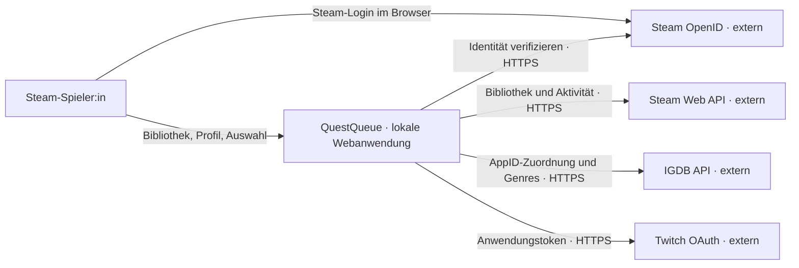
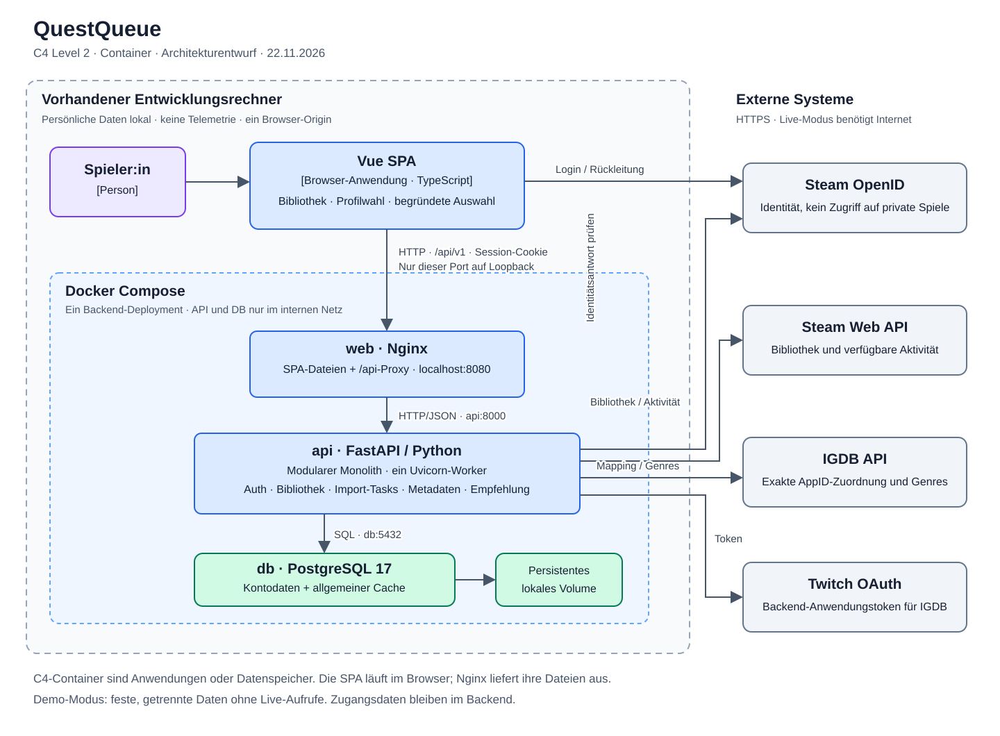
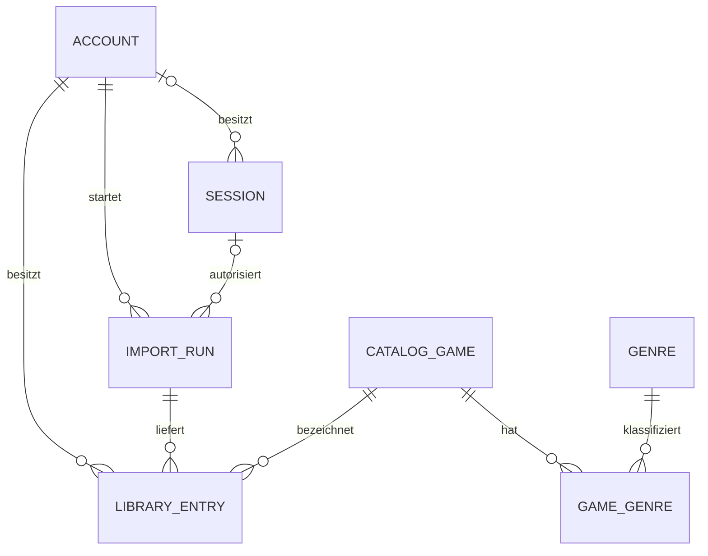

# QuestQueue – Architektur und Design

Stand: 23.11.2026 · Version 1.1 · Phase 2 – Architecture & Design

Wir bauen QuestQueue als **modularen Monolithen**: ein FastAPI-Backend mit getrennten Modulen, ein Vue-Frontend und eine PostgreSQL-Datenbank. Docker Compose soll das ganze System lokal starten. Backend-Aufteilung und Compose wurden im Gespräch am 22.11.2026 ausgewählt.

Das ist der Plan für Phase 3. Grundlage sind die [Anforderungen](requirements.md) und die [MVP-Abgrenzung](mvp.md) aus Phase 1. Die API-Probe vom 23.11.2026 umfasst inzwischen alle 195 importierten Spiele: 182 eindeutige IGDB-Zuordnungen, 180 mit Genres und fünf mit positiven aktuellen Minuten samt Genres. Der vorherige Stichprobenlauf belegt außerdem Cache-Wiederverwendung. Die Live-Profilberechnung, Steam-Login und PostgreSQL-Anwendungsintegration bleiben zu prüfen. Ergebnisse und Grenzen stehen in der [Integrationsprüfung](integration-spike.md).

## 1. Ziele, Rahmen und entscheidende Anforderungen

Der Hauptablauf ist: über Steam anmelden, Datenhinweis bestätigen, Bibliothek importieren, Profil ansehen und ein passendes ungespieltes Spiel auswählen. Wir arbeiten zu zweit und haben bis zum 09.12.2026 Zeit für die Implementierung. Deshalb soll der Aufbau überschaubar bleiben.

| Anforderung aus Phase 1 | Was das für die Architektur bedeutet |
| --- | --- |
| Lokal, 0 € für zusätzliche laufende Dienste | Frontend, Backend und Datenbank auf dem eigenen Rechner |
| US-01/US-02: zuletzt und meistgespielte Titel | Minuten, verfügbare Zeitpunkte und erkennbare Datenlücken speichern |
| US-03/US-05/US-09/US-13: Profile und begründete Auswahl | Gemeinsame Berechnung für Profil, Rangliste und Button |
| US-14/US-16, N-07: Anmeldung, Kontotrennung und Löschung | Serverseitige Sitzungen und kontobezogene Datenbankabfragen |
| US-15/US-19: API-Ausfälle und Cache | Gültige alte Daten behalten; Fehler und Datenalter anzeigen |
| N-01: Berechnung für 1.000 Bibliotheksspiele und bis zu 1.000 Katalogeinträge in jeweils höchstens 2 Sekunden | Daten gemeinsam laden und lokal berechnen; kein API-Aufruf beim Ranking |
| N-02: Steam-Import höchstens 30 Sekunden | Steam-Daten und längere Metadatenanreicherung trennen |
| N-06: Testbarkeit und Wartbarkeit | Datenadapter und Empfehlungslogik trennen; feste Testdaten verwenden |
| N-05: Tastaturbedienung | Verständliche Bedienelemente, sichtbarer Fokus und Textmeldungen |

Dashboard, Tags, Filter, externe Empfehlungen und Verlauf bleiben spätere Erweiterungen. Dafür bauen wir noch keine zusätzlichen Dienste oder Tabellen. AI hilft beim Entwurf; die Empfehlungen selbst entstehen durch die feste Baseline v1.

## 2. Zwei Architekturvarianten

### Variante A: Modularer Monolith – unsere Wahl

Vue spricht mit einer FastAPI-Anwendung. Darin gibt es Module für Anmeldung, Bibliothek, Import, Metadaten und Empfehlungen. Sie rufen sich direkt auf und nutzen eine PostgreSQL-Datenbank. Hintergrund-Tasks im API-Prozess bearbeiten gestartete Imports.

Die Module haben eigene Aufgaben, werden aber gemeinsam gestartet und ausgeliefert. Frontend und Datenbank laufen separat; das macht das Backend noch nicht zu Microservices.

### Variante B: Getrennte Backend-Dienste

Anmeldung/Bibliothek, Import/Metadaten und Empfehlungen würden als eigene Dienste laufen. Sie kommunizieren über interne APIs; Importaufträge könnten über eine Nachrichtenwarteschlange übergeben werden. Jeder Dienst verwaltet seinen Datenbereich und stellt benötigte Daten den anderen Diensten bereit.

Damit könnten wir Import und Empfehlungen unabhängig aktualisieren oder auf leistungsfähigere Rechner verlagern. Dafür müssten wir mehrere Dienste betreiben und mit ausgefallenen oder verspäteten Aufrufen und Nachrichten umgehen.

### Vergleich am konkreten Projekt

| Punkt | A: Modularer Monolith | B: Getrennte Dienste |
| --- | --- | --- |
| Umsetzung zu zweit | Ein Backend, weniger Einrichtung | Mehr Startkonfigurationen, interne APIs und Abstimmung |
| Beispiel Import | Bibliothek und Status gemeinsam speichern | Importdienst muss Änderungen zuverlässig weitergeben |
| Beispiel Kontolöschung | Persönliche Daten in einer DB-Transaktion löschen | Löschung und Abbruch laufender Arbeit über Dienste koordinieren |
| Fehlersuche | Ein Backend-Log und ein gemeinsamer Ablauf | Fehler können auch bei Dienstaufrufen oder Nachrichtenübergaben liegen |
| Ausfall | Ein Backendfehler kann die ganze API treffen | Bessere Eingrenzung; abhängige Dienste können trotzdem betroffen sein |
| Tests | Module und Adapter getrennt testbar | Dienste getrennt testbar, zusätzlich mehr Integrationstests |
| Erweiterung und Skalierung | Funktionen als Module ergänzen; Backend als Ganzes skalieren | Dienste unabhängig weiterentwickeln und skalieren |
| Betrieb | Wenige Prozesse, kein Broker | Mehr Prozesse und Pflege; auf einem Rechner nicht automatisch höhere Gebühren |

**Wir wählen A**, weil für unseren lokalen MVP die einfache Umsetzung und zuverlässige Datenverwaltung wichtiger sind als unabhängige Skalierung. Die Vorteile von B sind real, lösen aber aktuell kein nachgewiesenes Problem von QuestQueue.

Ein Monolith wird nicht automatisch gut strukturiert. Wir brauchen klare Modulgrenzen. Falls Importarbeit die API später nachweisbar ausbremst oder mehrere Teams unabhängig arbeiten, prüfen wir die Aufteilung neu. Zuerst ließe sich der Import auslagern. Siehe [ADR-001](adr/0001-modular-monolith.md).

## 3. Technologieauswahl und Alternativen

Der Kernstack stammt aus Phase 1. Hier begründen wir, warum er zu den Anforderungen passt.

| Bereich | Auswahl | Begründung und Abwägung |
| --- | --- | --- |
| Backend | Python, FastAPI, Pydantic, Uvicorn | Python passt zur Profilberechnung; FastAPI prüft Eingaben und unterstützt OpenAPI. Django wäre möglich, bringt aber hier kaum benötigte Funktionen mit. Sitzungen und Steam-Integration müssen wir trotzdem umsetzen. |
| Frontend | Vue 3, TypeScript, Vite, Vue Router | Komponenten für Spielkarten, Profilwahl und Datenstatus; TypeScript hilft beim Umgang mit API-Daten. React wäre ebenfalls geeignet, ein Wechsel bringt dem MVP aber keinen konkreten Vorteil. |
| Datenbank | PostgreSQL 17, aktuelle Korrekturversion | Beziehungen und Transaktionen passen zu Konten, Spielen und Genres. SQLite wäre leichter einzurichten, weicht aber vom gewählten Stack ab. PostgreSQL braucht einen eigenen Prozess. |
| Datenzugriff | SQLAlchemy 2.x, Psycopg 3, Alembic | Datenbankmodelle und nachvollziehbare Schemaänderungen. Ein ORM ersetzt unser Verständnis von SQL und Transaktionen nicht. |
| Externe APIs | HTTPX im Backend | Anbieteraufrufe und Timeouts bleiben an einer Stelle. Eigene Adapter übersetzen Antworten in unsere Datenformate und sind für Tests austauschbar. |
| Anmeldung | Steam OpenID 2.0, serverseitige Cookie-Sitzung | Keine eigenen Steam-Passwörter; Sitzungen beim Logout widerrufbar. OpenID 2.0 ist nicht OpenID Connect/OAuth und muss korrekt geprüft werden. |
| Lokaler Start | Docker Compose, Nginx | Gleiche Dienste für beide Teammitglieder, ein Browser-Ursprung über den Proxy. Docker und Virtualisierung müssen auf beiden Rechnern funktionieren. |
| Import und Cache | Begrenzte Backend-Tasks, PostgreSQL-Cache | Kein zusätzlicher Redis-/Celery-Dienst. Neustarts unterbrechen Tasks; automatische dauerhafte Jobausführung gehört nicht zum MVP. |
| Tests | pytest, Vue-Komponententests, Playwright | Erst Rechenlogik und Adapter offline, dann Hauptablauf im Browser prüfen; geplant für Phase 3/4. |

Python 3.13 ist der Ausgangspunkt, für den Frontend-Build eine unterstützte Node-LTS-Version. Genaue Paket- und Imageversionen prüfen und fixieren wir zu Beginn von Phase 3. PostgreSQL 17 wird laut [Supportübersicht](https://www.postgresql.org/support/versioning/) bis November 2029 unterstützt.

Grundlagen: [FastAPI](https://fastapi.tiangolo.com/features/), [Vue](https://vuejs.org/guide/introduction.html), [SQLAlchemy](https://docs.sqlalchemy.org/en/20/orm/session_transaction.html) und [Alembic](https://alembic.sqlalchemy.org/en/latest/). Weitere Technologien kommen nur dazu, wenn eine konkrete Anforderung sie nötig macht.

## 4. Architekturdiagramme

Wir verwenden den **C4-Systemkontext** für externe Abhängigkeiten und die **Container-Sicht** für Anwendungen und Datenspeicher. C4-Container sind nicht dasselbe wie Docker-Container: Vue läuft im Browser, Nginx liefert seine Dateien aus.

### C4 Level 1: Systemkontext



### C4 Level 2: Container



[PNG-Version](diagrams/c4-container.png) · [Kontextquelle](diagrams/c4-context.mmd) · [Containerquelle](diagrams/c4-container.mmd) · [ER-Diagramm](diagrams/data-model.mmd) · [Importablauf](diagrams/import-sequence.mmd)

| Komponente | Aufgabe | Geplanter Betrieb |
| --- | --- | --- |
| Vue SPA | Bibliothek, Profilwahl, Empfehlungen und Datenstatus anzeigen | Lokaler Browser |
| `web`: Nginx | Frontend ausliefern, `/api/*` an FastAPI weiterleiten | Nur `127.0.0.1:8080` am Host veröffentlichen |
| `api`: FastAPI | Sitzungen, Bibliothek, Import, Metadaten und Empfehlungen | Intern auf Port 8000, genau ein Uvicorn-Worker |
| `db`: PostgreSQL | Persönliche Daten und allgemeinen Metadaten-Cache speichern | Intern auf Port 5432, persistentes lokales Volume |
| Steam, IGDB, Twitch | Identität und externe Daten bereitstellen | HTTPS; Schlüssel bleiben im Backend |

Die gemeinsame Browser-Adresse ist `http://localhost:8080`. Für native Frontend-Entwicklung kann Vite auf Port 5173 denselben API-Pfad weiterleiten; Login-Rückleitung und erlaubte Adresse müssen dann dazu passen.

Die Diagramme zeigen den **geplanten Aufbau**. Ändert sich die Umsetzung, aktualisieren wir Diagramme, Datenmodell, API und betroffene ADRs zusammen.

## 5. Backend-Module und Abhängigkeiten

Geplante Struktur für Phase 3:

```text
backend/app/
  main.py              # Start und Ende der Anwendung, laufende Tasks beenden
  api/                 # Endpunkte, Eingabe- und Antwortformate
  auth/                # Steam-Login, Sitzungen, Datenhinweis, Löschung
  library/             # Bibliothek und Listen
  imports/             # Importstart, Fortschritt und Abbruch
  metadata/            # AppID-Zuordnung, Genres und Cache
  recommendations/     # Profil, Score und Begründung nach Baseline v1
  adapters/            # Steam, IGDB, Twitch und feste Demodaten
  persistence/         # Datenbankmodelle, Abfragen und Transaktionen
  config.py            # Lokale Backend-Konfiguration
frontend/src/
  api/                 # Backend-Aufrufe
  views/               # Seiten für Anmeldung, Bibliothek, Profile und Demo
  components/          # Spielkarten, Profilwahl und Statusanzeigen
  composables/         # Gemeinsamer Sitzungs- und Anfragezustand
```

Endpunkte prüfen Eingaben und rufen die passende Funktion auf. Datenbankabfragen bleiben im Datenzugriff, Anbieteraufrufe in Adaptern. Die Empfehlungslogik bekommt fertige Daten und kennt weder HTTP noch Datenbankzugänge. So können wir sie ohne Steam testen. Ein Profilwechsel darf keinen Import starten.

Für die Teamaufteilung bieten sich Backend/Import und Frontend/Darstellung an. API und Empfehlungsregeln stimmen wir gemeinsam ab. Kleine Funktionen und wenige Adapter reichen; ein allgemeines Plugin-Framework brauchen wir nicht.

## 6. Datenmodell

### 6.1 Beziehungen



Ein Konto hat mehrere Bibliothekseinträge. Ein Spiel kann in mehreren Konten vorkommen und mehrere Genres haben. Persönliche Minuten gehören deshalb zum Bibliothekseintrag, allgemeine Genres zum Katalog. Anonyme und Demo-Sitzungen haben kein Konto.

### 6.2 Tabellen

`PK` bedeutet Primärschlüssel, `FK` Fremdschlüssel. Zeitpunkte speichern wir als `timestamptz` in UTC. SteamIDs sind Zeichenfolgen, damit der Browser keine 64-Bit-Genauigkeit verliert. **Unbekannte Minuten bleiben `NULL`, sie sind nicht automatisch 0.**

| Tabelle | Wichtige Felder | Aufgabe |
| --- | --- | --- |
| `account` | `id UUID PK`, `steam_id VARCHAR(20) UNIQUE`, `notice_version`, `notice_accepted_at`, `last_import_started_at`, `steam_retry_after`, `created_at` | Verifizierte Identität und Datenhinweis zuordnen |
| `session` | `id UUID PK`, `token_hash UNIQUE`, `mode`, `account_id FK NULL`, `csrf_token`, `created_at`, `expires_at`, `revoked_at` | Browser-Sitzungen; nur `live` gehört zu einem Konto |
| `import_run` | `id UUID PK`, `account_id FK`, `authorizing_session_id FK NULL`, `kind`, `trigger`, `status`, `library_status`, `current_status`, `metadata_status`, Zeitpunkte, `rules_version`, `counts`, `error_code` | Importfortschritt und Teilergebnisse speichern |
| `library_entry` | PK `(account_id, app_id)`, `source_import_id FK`, `title`, `total_minutes BIGINT NULL`, `recent_minutes BIGINT NULL`, `last_played_at NULL`, `recent_evidence` | Persönlichen Bibliotheksstand speichern |
| `catalog_game` | `app_id BIGINT PK`, `igdb_id NULL`, `public_title NULL`, `mapping_status`, `normalization_version`, `fetched_at`, `attempted_at`, `last_attempt_status` | Allgemeine Metadaten und Abrufstand cachen |
| `genre` | `id BIGINT PK`, `name`, `provider`, `normalization_version` | Eindeutige Genres bereitstellen |
| `game_genre` | PK `(app_id, genre_id)`, beide FK | Genres ohne Duplikate zuordnen |
| `catalog_state` | Eine Zeile `id=1`, `revision BIGINT` | Änderungen am Katalog für die Ergebnisversion mitzählen |
| `provider_state` | `provider PK`, `retry_after`, `last_request_at`, `steam_external_source_id` | Gemeinsame API-Sperren und geprüfte IGDB-Steam-Quell-ID speichern |

Der Katalog enthält keine SteamID oder persönlichen Minuten. Neue AppIDs können dort als Platzhalter ohne private Felder entstehen. Mehrere Steam-AppIDs dürfen dieselbe IGDB-ID haben; diese ist deshalb nicht eindeutig. Erfolgreicher Metadatenabruf und letzter Versuch haben getrennte Zeitpunkte.

### 6.3 Regeln für gültige Daten

- Positive AppIDs, nichtnegative bekannte Minuten. Aktuelle Minuten dürfen bekannte Gesamtminuten nicht überschreiten. Ist nur das aktuelle Feld ungültig, behalten wir gültige Gesamtminuten. Ungültige zukünftige Zeitpunkte verwirft der Adapter.
- `library_entry(account_id, source_import_id)` verweist auf `import_run(account_id, id)`. Dieser zusammengesetzte Fremdschlüssel verhindert fremde Importzuordnungen; dafür erhält `import_run` zusätzlich `UNIQUE(account_id, id)`.
- Ein partieller eindeutiger Index erlaubt höchstens einen aktiven Import je Konto. Beim Start wird die Kontozeile kurz gesperrt, damit parallele Requests den 60-Sekunden-Abstand nicht umgehen.
- Persönliche Kinddaten werden mit `ON DELETE CASCADE` entfernt. Eine gelöschte Sitzung setzt `authorizing_session_id` auf `NULL`; der alte Task darf dann nichts Persönliches mehr speichern. Allgemeine Metadaten bleiben erhalten.
- Indizes auf Konto/Minuten/AppID und Konto/letztem Spielzeitpunkt/AppID helfen bei Listen. Der Session-Token-Hash erhält einen eindeutigen Index.

Aktive Jobstatus: `queued`, `steam`, `metadata`. Endstatus: `completed`, `partial`, `failed`, `cancelled`, `interrupted`. Der letzte gestartete Job ist nicht automatisch der letzte erfolgreiche Bibliotheksstand. Dafür zählen `library_status=available` und `library_completed_at`, auch bei einer nachweisbar gültigen leeren Bibliothek. `counts` enthält Anzahlen, keine Rohantworten.

### 6.4 Profile bei Bedarf berechnen

Wir speichern Bibliothek, Metadaten und Regelversion, aber keine zusätzlichen fertigen Profilgewichte oder Ranglisten. Beide Profile entstehen aus denselben Eingaben. Der Ergebnisstand ist `(import_id, catalog_revision, rules_version)`.

Eine kurze Lesetransaktion mit `REPEATABLE READ` lädt die zusammengehörenden Daten; danach wird im Speicher gerechnet. So mischen wir keinen neuen Katalog mit einer älteren Profilberechnung. Historische Empfehlungen werden nicht archiviert. Siehe [ADR-002](adr/0002-postgresql-and-derived-profiles.md).

Snapshots, Tags, Feedback und Genre-Ausschlüsse bekommen erst mit den jeweiligen Should-Stories eigene Tabellen und denselben Kontobezug/Löschpfad.

### 6.5 Spielzeit außerhalb der letzten 14 Tage

Gesamtminuten (`playtime_forever`) umfassen auch ältere Spielzeit und bilden All-Time Taste. Die 14-Tage-Minuten liefern Current Taste. Ein letzter Spielzeitpunkt zeigt nur die letzte Aktivität, keine komplette Folge von Sitzungen.

Die [verwendeten Steam-Endpunkte](https://partner.steamgames.com/doc/webapi/IPlayerService) bieten keinen Datumsbereich für eine beliebige persönliche Tages- oder Sitzungshistorie. Für US-08 speichern wir deshalb später bei jedem erfolgreichen Import einen Snapshot mit Konto, AppID, Erfassungszeitpunkt und Gesamtminuten. Aus zwei bekannten Ständen ergibt sich der beobachtete Zuwachs: 1.000 Minuten am ersten und 1.120 Minuten am zweiten Zeitpunkt ergeben 120 zusätzliche Minuten im tatsächlichen Intervall.

Diese Historie beginnt erst mit unserer Erfassung. Daraus werden keine genauen Spieltage oder früheren Sitzungen erfunden. Fehlende oder sinkende Werte bleiben Sonderfälle; Details regelt [US-08](requirements.md#us-08--playtime-over-time--should). Die Funktion bleibt eine Should-Erweiterung und verändert Current Taste der Baseline v1 nicht.

## 7. Abläufe und Fehlerbehandlung

### 7.1 Anmeldung

1. `GET /api/v1/session` liefert Sitzungsmodus und CSRF-Token und legt bei Bedarf eine anonyme Sitzung an.
2. Der Loginstart leitet zu Steam. Das Backend prüft die OpenID-Antwort: fester Provider, Signatur/Providerbestätigung, Rückleitungsadresse, Identität und einmaliger, an den Browser gebundener Loginzustand. Eine frei übergebene SteamID reicht nicht.
3. Erst danach wird das Konto zugeordnet und der Sitzungstoken erneuert. Kontowechsel widerruft die alte Browsersitzung. Sitzungen laufen nach 24 Stunden ohne stille Verlängerung ab.
4. Der Erstimport braucht den bestätigten Datenhinweis und einen bewussten Start. Bei späterer Anmeldung mit gültiger Bestätigung wird nur bei fehlendem Stand oder mindestens 24 Stunden alten Daten importiert. Laufender Job, Cooldown und Anbietersperren gelten weiterhin.

Der Datenhinweis nennt Datenarten, Zweck, Speicherland, Aktualisierung und Löschung. Erfolgreicher Login gibt keinen zusätzlichen Zugriff auf private Spieldaten. Ein Seiten-Reload startet keinen Import. Grundlagen: [Steam OpenID](https://partner.steamgames.com/doc/features/auth#web-browser-based-authentication-with-openid), [OpenID-Prüfungen](https://www.openid.net/specs/openid-authentication-2_0.html#verification). Bibliothek und lokaler Loginablauf müssen noch getestet werden.

### 7.2 Import in zwei Schritten

1. Sitzung, Datenhinweis, laufenden Job, mindestens 60 Sekunden seit letztem Start und Sperren prüfen. Job anlegen und mit `202 Accepted` samt Status-URL antworten. Doppelstart: `409`; zeitliche Sperre: `429` mit `Retry-After`.
2. Steam-Bibliothek und verfügbare aktuelle Aktivität innerhalb von **insgesamt 30 Sekunden ab Annahme des Auftrags** abrufen. Wartezeit und einzelne Netzwerk-/DB-Timeouts müssen in dieses Budget passen.
3. AppIDs und Feldwerte prüfen und deduplizieren. Bei Bibliotheksfehler bleibt der alte Stand erhalten. Eine mehrdeutige leere Antwort darf ihn nicht löschen. Bei isoliertem Current-Ausfall bleiben Gesamtwerte nutzbar; alte aktuelle Minuten werden nicht als neue ausgegeben.
4. Vor dem Speichern Konto, Sitzung und Job erneut prüfen. Bibliothek und erfolgreicher Status werden zusammen gespeichert. Danach folgt die getrennte Metadatenphase.
5. Nur fehlende, ungültige oder mindestens sieben Tage alte Metadaten nachladen, je AppID höchstens einmal pro Durchlauf. Zuordnung über exakte Steam-AppID und [`external_game_source`](https://api-docs.igdb.com/#external-game), nicht ähnliche Namen. Frischer Cache erspart den Abruf.
6. IGDB-Aufrufe nacheinander, mindestens eine Sekunde zwischen Starts. Mehrere AppIDs dürfen gebündelt werden. Bei `429` bis zum späteren Zeitpunkt aus Retry-After und mindestens 60 Sekunden sperren; danach neuer manueller Start. Auch andere Fehler erzeugen keine Retry-Schleife.
7. Teilstatus und Fortschritt anzeigen. Alte erfolgreiche Metadaten dürfen bei Fehlern sichtbar als veraltet genutzt werden, bei inkompatiblem Schema nicht. Fehlende Genres bleiben eine Lücke. `metadata_only` erneuert Metadaten, ohne das Bibliotheksdatum zu verändern.

Metadatenanreicherung kann insgesamt länger als 30 Sekunden dauern; einzelne Anbieteraufrufe bleiben auf höchstens 30 Sekunden begrenzt. Die UI kann vorher vorhandene Genres nutzen und fragt den Jobstatus während eines Imports etwa alle zwei Sekunden ab. Das ruft keine Anbieter auf.

Wir erlauben zunächst zwei aktive Import-Tasks insgesamt und einen Uvicorn-Worker. Bei voller Kapazität folgt vor Jobanlage `503 IMPORT_CAPACITY`. Vor weiteren Arbeitsschritten und zwischen Batches werden Sitzung und Abbruchsignal geprüft. Nach API-Neustart werden offene Jobs zu `interrupted`, ohne automatischen Wiederanlauf. Ein gespeicherter Status ist keine garantierte Weiterverarbeitung. Siehe [ADR-003](adr/0003-import-orchestration.md) und [FastAPI Background Tasks](https://fastapi.tiangolo.com/tutorial/background-tasks/#caveat).

### 7.3 Profil, Rangliste und Button

Die [Baseline v1 aus Phase 1](requirements.md#5-empfehlungsmethode-inhaltsbasierte-baseline-v1) bleibt unverändert:

- Gespielte Referenzen verteilen positive bekannte Minuten gleichmäßig auf ihre Genres. Die Genrebeiträge werden auf Summe 1 normalisiert. All-Time verwendet Gesamtminuten, Current nachgewiesene 14-Tage-Minuten desselben Imports.
- Kandidaten brauchen explizit 0 Gesamtminuten, Genres und positiven Score. Score = Mittelwert der Profilgewichte ihrer Genres; fehlende Profilgenres zählen mit 0.
- Ungerundeter Score absteigend, numerische AppID aufsteigend; höchstens fünf Titel. Rundung nur zur Anzeige. Für exakte Vergleiche kann die Berechnung rationale Brüche verwenden.
- Der Grund nennt das gemeinsame Genre mit dem höchsten positiven Gewicht und die Referenz mit dem größten Beitrag. Gleichstände lösen Genre-ID beziehungsweise AppID aufsteigend.
- `GET /recommendations` liefert Profil, Liste und `suggestion_app_id` gemeinsam. Der Button zeigt den ersten Titel daraus, ohne Zufallsauswahl oder Import. Bei Profilwechsel verwirft die UI verspätete Antworten der alten Auswahl.

Ohne Grundlage gibt es eine erklärte leere Antwort. Current unterscheidet nachweisbar fehlende Aktivität von nicht verfügbaren/unklaren Daten und verwendet keinen stillen All-Time-Ersatz. Das feste Beispiel liefert All-Time `201, 204, 202, 203`, Button `201`; Current `202, 204`, Button `202`.

### 7.4 Abmeldung und Löschung

Abmelden widerruft die Browsersitzung und stoppt aktive Jobs des Kontos, der gültige Bestand bleibt. Andere Sitzungen bleiben angemeldet, setzen aber keinen alten Job fort. Abgelaufene Sitzungen dürfen ebenfalls nichts mehr persönlich speichern.

Bestätigte Löschung entfernt Konto, persönliche Daten und Sitzungen in einer Transaktion. Schreibpfade sperren immer **Konto → Sitzung → Job**. Ein verspäteter Task prüft diese Berechtigung vor dem Speichern erneut. Er darf ein gelöschtes Konto niemals neu anlegen; das darf nur der verifizierte Loginpfad.

Vor der Löschung gespeicherte Ergebnisse werden mitgelöscht. Kam die Löschung zuerst, scheitert der spätere Schreibversuch. Eine laufende Antwort kann noch eintreffen, erlaubt aber keine neue Anfrage oder persönliche Speicherung aus dem alten Task. Allgemeine Metadaten bleiben. Die UI leert bei Logout, Löschung und Kontowechsel ihren persönlichen Zustand.

### 7.5 Offline-Demo

Die Demo nutzt eine Sitzung ohne SteamID und nur den festen Beispieldatensatz mit ergänzten Zeitpunkten. Sie liest keine persönlichen Kontodaten und ruft keine Live-Anbieter auf. Import, Datenhinweisbestätigung und Kontolöschung sind gesperrt. Vor Demo-Start aus einer Live-Sitzung muss regulär abgemeldet werden. „Demodaten“ bleibt sichtbar.

## 8. Schnittstellen und API-Vertrag

Der vollständige Entwurf steht in [api/openapi.json](api/openapi.json). Er legt die Formate für Phase 3 fest; die API läuft noch nicht. Basis: `/api/v1`, JSON-Antworten, Zeitpunkte als ISO 8601 in UTC, unbekannte Werte `null`.

| Methode und Pfad | Aufgabe und wichtige Antwort | Zugriff |
| --- | --- | --- |
| `GET /session` | Sitzungsmodus, CSRF-Token und Importstatus; `200` | Alle; ggf. anonyme Sitzung anlegen |
| `GET /auth/steam/start` | Zu Steam weiterleiten; `302` | Browsersitzung anlegen/verwenden |
| `GET /auth/steam/callback` | Login prüfen, zur UI zurückleiten; `303`, ungültig `400` | Einmaliger Loginvorgang |
| `POST /auth/logout` | Sitzung widerrufen; `204` | Sitzung + CSRF |
| `GET /data-notice` | Version und Hinweistext; `200` | Alle |
| `POST /data-notice/accept` | Aktuelle Version bestätigen; `204`, veraltet `409` | Live + CSRF |
| `POST /imports` | `kind=library/metadata_only`; `202` + `Location` | Live + Datenhinweis + CSRF |
| `GET /imports/{import_id}` | Status, Anzahlen und Fehler; `200` | Eigenes Live-Konto; fremder Job `404` |
| `GET /library` | `view=all/most_played/last_played`, optional `unplayed=true`; `200` | Live oder Demo |
| `GET /recommendations` | `profile=all_time/current`; Profil, Liste, Button-Auswahl; `200` | Live oder Demo |
| `DELETE /me` | Mit JSON-Body `confirm=true` eigene Daten löschen; `204` | Live + CSRF |
| `POST /demo/session` | Demo starten; `201`, bei aktiver Live-Sitzung `409` | Anonym/Demo + CSRF |
| `GET /health/live` | API antwortet; `200` | Ohne persönliche Daten |
| `GET /health/ready` | DB und Schema bereit; `200/503` | Ohne Anbieteraufruf |

Bibliotheksseiten nutzen `offset >= 0`, `limit=1..100`, Standard 50. Die allgemeine Liste sortiert nach AppID, Top-Ansichten enthalten höchstens zehn Spiele. Letzte Aktivität liefert `activity_order=timestamp/recent_unordered/unavailable`; ohne exakte Zeitpunkte wird keine zeitliche Reihenfolge behauptet. Der Ungespielt-Filter enthält nur bekannte 0 Minuten.

Empfehlungsantworten enthalten `data_version`, `imported_at`, `state`, `profile`, `coverage`, `items`, `suggestion_app_id`, `warnings`. Gewichte und Scores sind Zahlen zwischen 0 und 1. Jeder Vorschlag nennt AppID, Titel, Score und ein Begründungsobjekt mit Genre und Referenzspiel. Die Abdeckung bezieht sich auf alle importierten Spiele, die Referenzanzahl auf tatsächlich verwendete Spiele. OpenAPI enthält vollständige Beispiele für beide Profile.

Fehlerbeispiel:

```json
{
  "code": "IMPORT_COOLDOWN",
  "message": "Bitte warte vor dem nächsten Import.",
  "retry_after_seconds": 42
}
```

`401`: ungültige Sitzung; `403`: fehlende Berechtigung/Bestätigung oder CSRF-Fehler; `404`: fehlende oder fremde Ressource; `409`: Konflikt; `422`: ungültige Eingabe; `429`: zeitliche Sperre; `503`: fehlende Bereitschaft oder volle Importkapazität. Fehler nach bestätigtem Start erscheinen im Jobstatus. Fehlendes Profil oder keine Kandidaten ergeben eine normale leere Antwort mit `200`.

## 9. Sicherheit und lokaler Betrieb

| Thema | Geplante Lösung |
| --- | --- |
| Kontotrennung | Konto aus verifizierter Sitzung bestimmen; Abfragen nach `account_id` filtern. Frei übergebene Kontoparameter ablehnen, auch Job-IDs auf Zugehörigkeit prüfen. |
| Sitzung | Zufälliger Cookie-Token, nur Hash in DB; `HttpOnly`, `SameSite=Lax`, `Path=/`, kein `Domain`-Attribut. Rotation beim Login, Widerruf beim Logout. |
| CSRF | Sitzungsgebundener `X-CSRF-Token` und erwarteter `Origin` schützen schreibende Aufrufe vor fremden Webseiten. Steam-Callback nutzt den geprüften Loginzustand. |
| Geheimnisse und Logs | Schlüssel nur in lokaler Backend-Konfiguration, nie in Frontend-Build/Git/Logs. Keine SteamIDs, Sitzungstoken, Callback-Querys oder privaten Rohantworten loggen. |
| Netzwerk | Nur Web-Port auf Loopback; API/DB intern. Erwarteten Host prüfen, keine beliebigen Proxy-Header oder Wildcard-CORS-Freigaben akzeptieren. |
| Lokales HTTP | `Secure=false` nur für lokalen HTTP-Modus; bei späterem HTTPS `Secure=true`. |
| Speicherung | Lokales Volume, keine Telemetrie/externen MVP-Backups. Persönliche Antworten: `Cache-Control: no-store`; keine persönlichen API-Daten in Local Storage oder Service-Worker-Cache. |

Der Datenhinweis nennt das tatsächliche Land des Rechners; dieser Wert muss vor dem Live-Test gesetzt sein. Lokale Speicherung und nötiger Internetzugriff zu den Anbietern sind getrennte Dinge.

## 10. Nachverfolgbarkeit und geplante Verifikation

| Anforderungen | Baustein | Späterer Test |
| --- | --- | --- |
| US-01/US-02 | Bibliothek, Aktivitätszustände | Sortierung, unbekannte Werte, Gleichstände |
| US-03/US-05/US-09/US-13 | Baseline und gemeinsames Liste-/Button-Ergebnis | Akzeptanzbeispiel für Profile und Gründe |
| US-14, N-07 | OpenID und kontogebundene Abfragen | Zwei Konten, manipulierter Login, fremder Job |
| US-15, N-02 | Importstatus und Timeouts | Timeout, 429, mehrdeutige Antworten, Current-Ausfall |
| US-16, N-04 | Löschtransaktion und erneute Berechtigungsprüfung | Logout/Löschung während Import, Neustart, zweites Konto erhalten |
| US-17, N-06 | Getrennter Demo-Adapter, reine Rechenfunktionen | Offline-Ablauf ohne Live-Zugriff |
| US-19 | Mapping und Cache | Live-Stichprobe, Cache nach Neustart, Zuordnungslücken |
| N-01 | Lokale Berechnung | Je Profiltyp 20 Läufe mit 1.000/1.000 Einträgen, jeder höchstens 2 Sekunden |
| N-03/N-05 | Backend-Geheimnisse, zugängliche Oberfläche | Schlüsselprüfung und Hauptablauf nur per Tastatur |
| Altersregeln | Importstart und Cachealter | 23:59 h / 24 h, 59 s / 60 s, knapp unter / genau sieben Tage |

Das ist ein Testplan, keine Liste bestandener Anwendungstests. Die Grenzen des vorhandenen Prüfskripts stehen im [Integrationsdokument](integration-spike.md).

## 11. Risiken und Grenzen

| Risiko | Unser Umgang damit |
| --- | --- |
| Zu wenige eindeutige IGDB-Zuordnungen | Stichprobe durchführen, Genres und Lücken zählen; SteamSpy erst nach eigener Prüfung ergänzen. |
| Steam liefert Daten nicht | Sichtbarkeit und Felder testen; unbekannt lassen, keinen sicheren Privatstatus aus leerer Antwort ableiten. |
| Import bremst API aus | Tasks begrenzen, Transaktionen kurz halten; erst bei gemessenem Bedarf auslagern. |
| Neustart unterbricht Import | `interrupted` anzeigen, gültigen Bestand behalten, bewusst neu starten. |
| Genre-/Minutenprofil trifft Geschmack nur grob | Gründe anzeigen und später qualitativ bewerten; neue Gewichtung braucht neue Regelversion. |
| Einarbeitung dauert länger als gedacht | Zu Beginn von Phase 3 Login, Compose, SQLAlchemy und Migrationen gemeinsam durchgehen. |

Wir haben noch nicht nachgewiesen, dass beide Teammitglieder alle Werkzeuge ausreichend kennen. Beide sollen den Start erklären, eine DB-Änderung nachvollziehen und einen API-Fehler finden können. Bei Lücken planen wir eine kurze gemeinsame Übung statt weiterer Infrastruktur.

## 12. AI-Unterstützung und kritische Prüfung

Werkzeug: ChatGPT/Codex. Auftrag war, Phase 2 aus Phase 1 abzuleiten und wichtige Entscheidungen mit verständlichen Optionen abzufragen. Die Tabelle fasst Beiträge zusammen; sie ist keine Liste wortgetreu eingegebener Einzelprompts.

| AI-Beitrag | Verwendung | Kritische Bewertung |
| --- | --- | --- |
| Monolith und getrennte Dienste vergleichen | Monolith im Gespräch ausgewählt | Einfacherer Betrieb passt; gemeinsamer Prozess bleibt ein Engpass. Deshalb Module trennen und Importarbeit begrenzen. |
| Ganzes System mit Compose starten | Im Gespräch ausgewählt | Einheitlicher Start hilft, Docker muss aber auf beiden Rechnern funktionieren. |
| Datenmodell, abgeleitete Profile und API entwerfen | Grundlage für Phase 3 | Fertige Profile brauchen nicht automatisch eigene Tabellen. Kontotrennung muss durch Abfragen, Sitzungen und Beziehungen abgesichert werden. |
| Steam- und Metadatenphase trennen | Im Entwurf berücksichtigt | Gesamte Genresuche kann länger als 30 Sekunden dauern. Hintergrund-Tasks sind weder Scheduler noch garantiert dauerhafte Jobs. |
| Hosting vergleichen | Lokalen Betrieb beibehalten | Free-Tiers können schlafen oder ablaufen. Ein günstiger Tarif ist nicht automatisch gerade buchbar. |

**Bewusst hinterfragt haben wir den AI-Vorschlag „modularer Monolith“:** Lange Imports können interaktive Aufrufe im selben Prozess ausbremsen. Wir behalten ihn, weil getrennte Dienste für den MVP mehr Betrieb verursachen, und begrenzen dafür die Importarbeit. Ob das genügt, prüfen wir später mit N-01/N-02. Damit ist der Nachteil benannt und eine überprüfbare Maßnahme festgelegt.

Ausdrücklich bestätigt sind Backend-Aufteilung und Compose. Tabellen, Sitzungsschutz und Jobstatus sind daraus abgeleitete AI-gestützte Entwurfsarbeit. Die AI-Prüfung ist kein unabhängiger Review. Zugangsdaten wurden nicht übergeben. Die Team-Berichte vom 23.11.2026 belegen erste Live-API-Ergebnisse; N-01-/N-02-Anwendungsmessungen und der vollständige Loginablauf stehen noch aus. Die erste AI-gestützte Stichprobe verfehlte alle fünf aktuellen Referenzen. Diagnosezähler deckten diese Lücke auf; `--all-games` erlaubt nun die Prüfung des ganzen importierten Bestands.

## 13. Phase-2-Definition of Done

### Abgleich mit der vollständigen Aufgabenstellung

| Vorgabe | Abdeckung |
| --- | --- |
| 1. Varianten, Technologien, Diagramm, Datenmodell, API, ADRs, Hosting, AI | Abschnitte 2–8/12, [ADRs](adr/README.md), [Hosting](hosting.md) |
| 2. Requirements First, Einfachheit, Trade-offs, Erweiterbarkeit | Abschnitte 1–3/5–7/10; keine vorgezogenen Should-Funktionen |
| 3. MVP, Zeit, Security, Performance, Maintainability und AI-Kritik | Abschnitte 1/5/9–12 |
| 4. Deliverables | Dieses Dokument, Hosting, vier ADRs, C4-/ER-Diagramme und OpenAPI |
| 5. Typische Fehler vermeiden | Konkreter Variantenvergleich, offene Lernpunkte; Diagramme als Plan gekennzeichnet und gemeinsam nachzuführen |
| 6. Bewertungsschwerpunkte | Anforderungsbezug, begründete Entscheidungen, Alternativen, AI-Kritik und gemeinsame Daten-/API-Regeln |
| 7. Definition of Done | Folgende Checkliste und gemeinsamer Erklärungsdurchgang |

### Checkliste aus der Aufgabenstellung

| Kriterium | Stand |
| --- | --- |
| Architektur verständlich dokumentiert und visualisiert | Abschnitte 4/5 und C4-Diagramme |
| Technologieentscheidungen begründet | Abschnitt 3 und ADRs |
| Mindestens zwei Varianten verglichen | Abschnitt 2 |
| Mindestens zwei ADRs | Vier vorhanden |
| Datenmodell und API konkret genug zum Implementierungsstart | Tabellen, Beziehungen, Regeln, Endpunkte und vollständige OpenAPI-Beispiele vorhanden |
| Studierende können Entscheidungen erklären | **Vom Team gemeinsam durchzugehen**; das kann ein Dokument allein nicht nachweisen |

Die schriftlichen Deliverables sind abgedeckt. Laufende Anwendung, Performance-Abnahme und vollständige Integrationstests sind in der vorliegenden Aufgabe keine zusätzlichen schriftlichen Phase-2-Deliverables. **Der in Phase 1 für Phase 2 zugesagte frühe Steam-/IGDB-Integrationsnachweis bleibt trotzdem offen.** Wir führen ihn separat in [integration-spike.md](integration-spike.md); er wird nicht nachträglich gestrichen oder als erledigt ausgegeben.

### Fragen für unser Projektgespräch

| Frage | Was wir erklären können sollten |
| --- | --- |
| Warum keine Microservices? | Zwei Personen, lokaler MVP, kurze Zeit; direkte Aufrufe und gemeinsame Transaktionen sparen Aufwand. |
| Warum PostgreSQL? | Konten, Bibliothek und Genres hängen zusammen; Beziehungen und Transaktionen sichern sie ab. |
| Warum sind unbekannte Minuten nicht 0? | Nur ausdrücklich 0 Minuten belegen einen ungespielten Kandidaten. |
| Was unterscheidet Current und All-Time? | Dieselbe Bibliothek, aber 14-Tage- statt Gesamtminuten; kein stiller Ersatz bei Datenlücken. |
| Warum zwei Importphasen? | Steam rechtzeitig abschließen, langsamere Genresuche getrennt anzeigen. |
| Was passiert nach Logout während Import? | Sitzung widerrufen, Task stoppen und Berechtigung vor späterem Speichern erneut prüfen. |
| Warum lokaler Betrieb? | 0-€-Dienstbudget und lokale persönliche Daten sind festgelegt. |
| Welche AI-Empfehlung haben wir hinterfragt? | Monolith: passend, aber möglicher Engpass; Begrenzung und Messung statt blindem Übernehmen. |

## 14. Entscheidungs- und Quellenverzeichnis

- [ADR-001 – Modularer Monolith](adr/0001-modular-monolith.md)
- [ADR-002 – PostgreSQL und abgeleitete Profile](adr/0002-postgresql-and-derived-profiles.md)
- [ADR-003 – Zweistufiger Import](adr/0003-import-orchestration.md)
- [ADR-004 – Lokaler Compose-Betrieb](adr/0004-local-compose-hosting.md)
- [Hostingvergleich mit Preisstand und Quellen](hosting.md)
- [Integrationsprüfung](integration-spike.md)

Quellen sind im Text verlinkt; die [Phase-1-Quellen](requirements.md#10-quellen) gelten weiterhin. Support- und Hostingangaben wurden am 23.11.2026 erneut geprüft. Offene Live-Tests bleiben davon getrennt.
